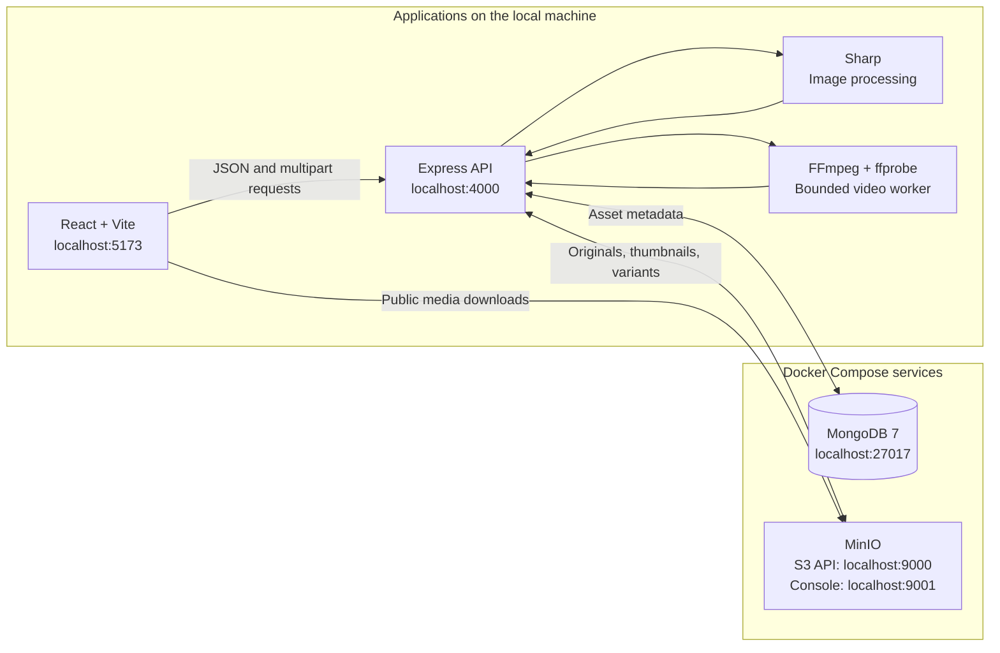

# Frame - Media Asset CMS

Frame is a media management application built for the **Build91 SDE Intern Evaluation Project: Media Asset CMS Engine**. It lets users upload images and videos, preview and optimize them, edit metadata, and replace a file while keeping its existing public URL.

The project uses React, Express, MongoDB, and S3-compatible object storage. The default local setup runs MongoDB and MinIO through Docker Compose, so an AWS or Cloudflare account is not needed to run it locally.

The local library is displayed as **Dhruv-assets**. Its actual storage bucket is `dev-assets`, which preserves existing asset URLs. Only this bucket is enabled by default; the backend supports additional preconfigured buckets through environment variables.

## Contents

- [Run locally](#run-locally)
- [Implemented assignment features](#implemented-assignment-features)
- [Architecture](#architecture)
- [Project structure](#project-structure)
- [Configuration](#configuration)
- [Using the application](#using-the-application)
- [API overview](#api-overview)
- [Tests and production build](#tests-and-production-build)
- [Troubleshooting](#troubleshooting)
- [Implementation limits](#implementation-limits)
- [Demo walkthrough](#demo-walkthrough)

## Run locally

### 1. Prerequisites

Install the following before starting:

| Tool | Requirement |
| --- | --- |
| Git | Used to clone the repository. |
| Node.js and npm | Use Node.js 22.12 or newer. Node.js 20.19 is also supported by the package requirements. |
| Docker with Compose v2 | Runs MongoDB and MinIO. On Windows, start Docker Desktop and use Linux containers. |
| Browser | Used to open the dashboard. |

Check that the tools are available:

```powershell
git --version
node --version
npm.cmd --version
docker --version
docker compose version
```

**Windows commands use `npm.cmd` to avoid PowerShell execution-policy errors. On macOS/Linux, use `npm` in its place.**

The first installation needs an internet connection to download npm packages, the bundled media binaries, and Docker images. Sharp, FFmpeg, and ffprobe are installed through backend dependencies; a separate system FFmpeg installation is not required for supported platforms.

### 2. Clone the repository

```sh
git clone https://github.com/dhruv086/frame-media-library.git
cd frame-media-library
```

Run all remaining commands from this repository root. There is no root `package.json`; dependencies and scripts belong to `backend/` and `frontend/`.

### 3. Create environment files and install dependencies

Choose the commands for your operating system. Existing environment files are preserved.

**Windows PowerShell:**

```powershell
if (-not (Test-Path -LiteralPath backend/.env)) {
    Copy-Item backend/.env.example backend/.env
}
if (-not (Test-Path -LiteralPath frontend/.env.local)) {
    Copy-Item frontend/.env.example frontend/.env.local
}

npm.cmd --prefix backend ci
npm.cmd --prefix frontend ci
```

**macOS/Linux:**

```sh
if [ ! -f backend/.env ]; then
    cp backend/.env.example backend/.env
fi
if [ ! -f frontend/.env.local ]; then
    cp frontend/.env.example frontend/.env.local
fi

npm --prefix backend ci
npm --prefix frontend ci
```

`npm ci` installs the versions recorded in each committed lockfile. For a fresh clone, the example environment files already contain the values needed for local development. If reusing an existing setup, compare your environment files with the [configuration below](#configuration).

### 4. Start MongoDB and MinIO

Make sure Docker is running, then execute:

```sh
docker compose -f backend/docker-compose.yml up -d
docker compose -f backend/docker-compose.yml ps -a
```

Before starting the backend, confirm that:

- `mongo` is running.
- `minio` is running and healthy.
- `minio-init` has exited with code `0`.

The initializer creates `dev-assets` and enables public downloads for the local previews. **An exited `minio-init` container is expected:** it runs once to initialize the bucket.

If initialization fails, inspect its logs:

```sh
docker compose -f backend/docker-compose.yml logs minio-init
```

### 5. Start the backend in Terminal 1

Open a terminal at the repository root and leave this command running:

```powershell
npm.cmd --prefix backend run dev
```

Wait for:

```text
Media Asset CMS listening on http://localhost:4000
```

Check the API in your browser at **http://localhost:4000/api/health**. A ready backend returns:

```json
{ "status": "ok", "database": "connected" }
```

This endpoint checks the MongoDB connection. The storage check is available separately in the [testing section](#tests-and-production-build).

### 6. Start the frontend in Terminal 2

Open another terminal at the repository root and leave this command running:

```powershell
npm.cmd --prefix frontend run dev
```

Open **http://localhost:5173**. The dashboard should show **Connected** and the **Dhruv-assets** bucket. A fresh installation has an empty gallery; upload a file to add your first asset.

### Local services

| Service | Address | Purpose |
| --- | --- | --- |
| Frontend | http://localhost:5173 | Media library dashboard. |
| Backend | http://localhost:4000 | Uploads, metadata, replacement, and optimization APIs. |
| Health check | http://localhost:4000/api/health | Backend database readiness. |
| MongoDB | `mongodb://localhost:27017/cms` | Asset metadata; this is a database URI, not a browser page. |
| MinIO S3 API | http://localhost:9000 | Stores and serves original files, thumbnails, and variants. |
| MinIO console | http://localhost:9001 | Inspect the local bucket and stored objects. |

Local MinIO console credentials are **`minioadmin` / `minioadmin`**. These are development credentials from the Compose configuration. The React and Express applications run on your machine; Compose runs the database and object store.

### Stop and restart

Press `Ctrl+C` in each application terminal to stop the frontend and backend. Stop the storage/database containers with:

```sh
docker compose -f backend/docker-compose.yml stop
```

MongoDB and MinIO data persist in named Docker volumes. To resume later, run the Compose `up -d` command and start the two application terminals again. Environment files and dependencies only need to be set up once unless configuration or dependencies change.

## Implemented assignment features

| Assignment requirement | Project implementation |
| --- | --- |
| Secure S3 integration and preconfigured buckets | AWS SDK v3 with backend-only credentials, a validated bucket allowlist, configurable public URLs, and automatic multipart uploads. The local configuration enables `dev-assets`; multiple buckets can be configured. |
| Smart content replacement | Overwrites the same storage key while retaining the original filename, extension, MIME type, bucket, and public URL. Increments the version, regenerates the thumbnail, and invalidates optimized variants. |
| Image and video gallery | Responsive dashboard with generated thumbnails, image previews, video playback, metadata, pagination, and loading/error/empty states. |
| Search and filtering | Case-insensitive filename search, format filters, upload-date ranges, and bucket selection. |
| Image optimization | Sharp-based resizing, quality adjustment, and conversion to WebP, AVIF, JPEG, or PNG. Shows actual output dimensions, file size, and savings. |
| Video optimization | FFmpeg-based resolution, bitrate, codec, and CRF quality controls. Produces H.264/MP4 or VP9/WebM, with background processing status and saved variants. |
| Attribute management | Editable alt text, tag chips, and optional expiry dates that can be cleared. |
| Upload and error handling | Multiple-file selection, per-file upload progress, retry controls, duplicate detection, file-size/type/content validation, safe API errors, and cleanup/rollback on failures. |

Additional actions include copying the original URL and deleting an asset together with its thumbnail and generated variants.

**Supported uploads:** JPG, JPEG, PNG, WebP, GIF, AVIF, MP4, WebM, and MOV. The default limit is **200 MiB per file** (`200 x 1024 x 1024` bytes). The UI labels this as 200 MB. Each API upload contains one file; the multi-file UI sends files individually.

## Architecture



### How media is handled

1. **Upload:** the browser sends a file and bucket identifier to Express. The server validates the file, stores its original bytes, extracts metadata, creates a thumbnail, and saves an asset record in MongoDB. Failed processing or persistence triggers storage cleanup.
2. **Gallery:** the API returns filtered, paginated asset metadata. The browser loads thumbnails and previews from the configured public storage URLs.
3. **Image optimization:** Sharp reads the original through the authenticated storage client, generates the requested variant, and caches it in storage. The API redirects to its public URL.
4. **Video optimization:** the API persists a job and queues FFmpeg processing. The UI polls the asset record until the variant is ready or failed. Ready variants remain available after reopening the preview.
5. **Replacement:** the server validates the matching format, overwrites the original key, regenerates the thumbnail, removes old variants, and increments the asset version. Existing metadata is preserved.

### Technology stack

| Layer | Technology |
| --- | --- |
| Frontend | React 19, Vite 7, JavaScript/JSX, plain CSS |
| Backend | Node.js, Express 5, JavaScript ES modules |
| Database | MongoDB 7 with Mongoose |
| Storage | AWS SDK v3; local MinIO; configurable AWS S3 or Cloudflare R2 |
| Image processing | Sharp |
| Video processing | FFmpeg and ffprobe through bundled binaries |
| Testing | Node.js test runner, HTTP/curl checks, Chromium browser automation |

## Project structure

```text
frame-media-library/
|-- README.md                     # Setup, features, architecture, and usage
|-- .gitignore
|-- backend/
|   |-- .env.example              # Local backend configuration template
|   |-- docker-compose.yml        # MongoDB, MinIO, and bucket initialization
|   |-- package.json
|   |-- src/
|   |   |-- config/               # Environment, MongoDB, and S3 client setup
|   |   |-- middleware/           # Upload parsing and centralized errors
|   |   |-- models/               # Asset metadata and video variants
|   |   |-- routes/               # Asset and bucket endpoints
|   |   |-- services/             # Storage, assets, images, and video jobs
|   |   |-- utils/                # Validation, async helpers, and locks
|   |   |-- app.js                # Express application
|   |   `-- index.js              # Startup and shutdown
|   |-- test/                     # Unit and media-processing tests
|   |-- scripts/                  # API, integration, and storage checks
|   |-- API.md                    # Full API contract
|   |-- R2_SETUP.md               # Optional Cloudflare R2 setup
|   `-- TEST_REPORT.md            # Verification details and coverage
`-- frontend/
    |-- .env.example              # Backend API URL template
    |-- package.json
    |-- src/
    |   |-- api/                  # HTTP requests and upload progress
    |   |-- components/           # Gallery, dialogs, and media controls
    |   |-- hooks/                # Asset loading and notifications
    |   |-- pages/                # Dashboard
    |   |-- utils.js              # Validation, formatting, and bucket label
    |   `-- styles.css            # Layout and responsive styling
    |-- tests/                    # Client and utility tests
    `-- scripts/                  # API contract and browser checks
```

## Configuration

### Backend: `backend/.env`

The default local values are:

```dotenv
PORT=4000
CLIENT_ORIGIN=http://localhost:5173
S3_ENDPOINT=http://localhost:9000
S3_ACCESS_KEY=minioadmin
S3_SECRET_KEY=minioadmin
S3_REGION=us-east-1
BUCKETS=dev-assets
BUCKET_PUBLIC_URLS=dev-assets=http://localhost:9000/dev-assets
MONGO_URI=mongodb://localhost:27017/cms
MAX_UPLOAD_MB=200
```

| Variable | Purpose |
| --- | --- |
| `PORT` | Port used by Express. |
| `CLIENT_ORIGIN` | Frontend origin allowed by the API's CORS configuration. |
| `S3_ENDPOINT` | S3-compatible API endpoint. Leave empty to use AWS S3's regional endpoint. |
| `S3_ACCESS_KEY`, `S3_SECRET_KEY` | Explicit credentials used only by the backend storage client. |
| `S3_REGION` | Storage signing region; local MinIO uses `us-east-1`, and R2 uses `auto`. |
| `BUCKETS` | Comma-separated allowlist of existing storage buckets. |
| `BUCKET_PUBLIC_URLS` | Comma-separated `bucket=public-base-url` pairs, with one mapping for every allowed bucket. |
| `MONGO_URI` | MongoDB connection URI for asset metadata. |
| `MAX_UPLOAD_MB` | Backend upload limit in MiB. The frontend currently enforces a fixed 200 MiB limit. |

### Frontend: `frontend/.env.local`

```dotenv
VITE_API_URL=http://localhost:4000
```

Restart the relevant application after changing its environment. Keep credentials in backend environment files; `VITE_` values are exposed to the browser. Actual environment files are ignored by Git; example files are committed.

### Using AWS S3 or Cloudflare R2

The local installation uses MinIO. To use another provider, configure its endpoint/region, credentials, allowed buckets, and public download URLs in `backend/.env`. Create the buckets and configure their public read access and browser CORS before uploading. A successful backend upload alone does not guarantee that the browser can download the file.

For Cloudflare-specific instructions, see [R2_SETUP.md](backend/R2_SETUP.md). Changing providers does not migrate existing objects or rewrite saved MongoDB URLs. Use a separate database when testing another provider against a new set of assets.

## Using the application

### Upload

1. Open the dashboard and select **Dhruv-assets**.
2. Select **Upload assets**, then browse for files or drop them into the upload area.
3. Select **Upload**. Each file shows its own progress and result.
4. Select **Done** to return to the gallery.

An existing normalized filename in the same bucket is rejected with a message suggesting **Replace**. The server checks the extension, MIME type, and decoded media content.

### Replace a file while keeping its URL

1. Copy the asset's original URL if you want to compare it afterward.
2. Select **Replace** on its gallery card.
3. Choose a file with the same extension and MIME type, then select **Replace content**. For example, a `.png` asset needs another `.png`; `.jpg` and `.jpeg` are treated as different extensions.
4. Confirm that the version increases and the original URL remains unchanged.

For example, uploading `My Photo.PNG` creates the normalized storage key `my-photo.png`. Replacing it with `updated-photo.png` keeps `my-photo.png`, the original display filename, and its URL. The app adds version parameters to its displayed media to refresh previews. External clients using the unchanged URL can retain old bytes for up to the original file's five-minute cache lifetime.

### Preview and optimize

Select **Preview** on a gallery card to inspect the original media and its metadata.

- **Images:** choose width, output format, and quality, then select **Generate preview**. Compare **Original / Optimized** and use **Open optimized** to view the result. API width/height bounds are 1-4000 pixels, quality is 1-100, and output formats are WebP, AVIF, JPEG, and PNG.
- **Videos:** choose a 480p, 720p, or 1080p resolution limit, a video bitrate limit, H.264/MP4 or VP9/WebM, and CRF quality. Select **Generate video preview** and wait for encoding. Resolution preserves aspect ratio without upscaling. Lower CRF values favor higher quality; actual size and total bitrate depend on the content and include audio/container overhead.

Optimization creates a separate derivative and preserves the original file. Savings reflect actual output bytes; some settings can produce a larger file. Repeated requests reuse cached variants for the current asset version.

### Search, edit, and delete

- Search by filename or filter by format and upload-date range. **Reset** clears the filters.
- Select **Edit metadata** to change alt text, add/remove tags, and set or clear expiry. The selected expiry is stored as the end of that day in UTC. It does not automatically delete or block access to the file.
- Select **Copy URL** to copy the original public URL.
- Select **Delete** and confirm to remove the original, thumbnail, variants, and database record.

## API overview

The default API base is `http://localhost:4000`. Media routes are mounted directly at `/assets` and `/buckets`; only the health endpoint has an `/api` prefix.

| Method | Route | Purpose |
| --- | --- | --- |
| `GET` | `/api/health` | Database readiness. |
| `GET` | `/buckets` | Allowed buckets and public URL mappings. |
| `POST` | `/assets` | Upload multipart fields `file` and `bucket`. |
| `GET` | `/assets` | Search, filter, and paginate assets. |
| `GET` | `/assets/:id` | Read one asset and video variant statuses. |
| `PUT` | `/assets/:id/replace` | Replace using multipart field `file`. |
| `PATCH` | `/assets/:id` | Update `altText`, `tags`, and/or `expiresAt`. |
| `GET` | `/assets/:id/optimized` | Generate/reuse an image variant and redirect to it. |
| `POST` | `/assets/:id/transcode` | Queue video optimization or return cached output. |
| `DELETE` | `/assets/:id` | Delete the asset and its stored media. |

Assets store filenames, format/MIME type, dimensions, size, duration, bucket/key, public URLs, version, ETag, editable attributes, and timestamps. Video records also store codec information and variant/job metadata.

Errors use a consistent envelope:

```json
{
  "error": {
    "code": "DUPLICATE",
    "message": "An asset with this filename already exists in this bucket. Use Replace to update it."
  }
}
```

See [API.md](backend/API.md) for request/response shapes, query parameters, status codes, and video settings.

## Tests and production build

Run these commands from the repository root after creating the environment files and installing dependencies. On macOS/Linux, replace `npm.cmd` with `npm`.

| Command | What it checks | Services required |
| --- | --- | --- |
| `npm.cmd --prefix backend test` | Configuration, validation, errors, storage mocks, and real image/video processing. | No running database/API; backend environment must be configured. |
| `npm.cmd --prefix backend run test:api` | Real HTTP/media workflows, filtering, replacement, rollback, concurrency, and video jobs. Starts its own isolated API. | MongoDB and MinIO. |
| `npm.cmd --prefix backend run test:integration` | Curl-based upload, replacement, optimization, metadata, and deletion checks. | Running backend, MongoDB, MinIO, and curl. |
| `npm.cmd --prefix backend run test:storage` | Actual storage operations, public downloads, CORS, and multipart uploads. | Configured storage provider. |
| `npm.cmd --prefix frontend test` | API client, upload progress, validation, formatting, and expiry behavior. | No running services. |
| `npm.cmd --prefix frontend run test:api` | Read-only health, bucket, gallery, and available asset-detail contracts. | Running backend and its services. |
| `npm.cmd --prefix frontend run test:browser` | Real UI workflows, optimization/playback, responsive layouts, and cleanup. | Both applications, MongoDB, MinIO, and a Chromium browser. |
| `npm.cmd --prefix frontend run build` | Creates the production frontend in `frontend/dist/`. | No running services. |

The isolated backend API suite uses its own `cms_test_*` database and a 12 MiB test limit, then cleans up its fixtures. Storage and browser checks create uniquely named objects/assets and remove their own fixtures. The current local storage provider is MinIO; live AWS/R2 behavior requires testing with that provider's actual configuration.

The browser script defaults to Microsoft Edge's Windows installation path. Set `BROWSER_PATH` to your Chromium executable if using another browser or operating system. Browser screenshots are written to ignored `frontend/test-results/`.

After building, preview the frontend locally with:

```powershell
npm.cmd --prefix frontend run preview
```

Stop the Vite development server first because preview also uses port 5173. The backend and storage/database services must remain running. To run the backend without nodemon, use `npm.cmd --prefix backend start` instead of its development command.

For detailed coverage and recorded verification results, see [TEST_REPORT.md](backend/TEST_REPORT.md).

## Troubleshooting

| Symptom | What to check |
| --- | --- |
| `npm.ps1 cannot be loaded` in PowerShell | Run `npm.cmd` instead of `npm`. |
| Docker cannot connect to its engine | Start Docker Desktop or your Docker daemon. On Windows, confirm Linux containers are enabled, then rerun Compose. |
| A port is already in use | Check ports 4000, 5173, 27017, 9000, and 9001. Stop the conflicting service. If changing a port, update its Compose mapping/environment values together; the frontend uses a strict port. |
| Backend cannot connect to MongoDB | Check `docker compose -f backend/docker-compose.yml ps -a` and the `mongo` logs. Confirm `MONGO_URI` matches the running database. |
| `dev-assets` does not exist or uploads fail | Check the `minio-init` logs. After MinIO is healthy, rerun `docker compose -f backend/docker-compose.yml run --rm minio-init`. |
| Dashboard says Unavailable | Open `/api/health`, confirm the backend is running, and check `VITE_API_URL` and `CLIENT_ORIGIN`. Restart the apps after environment changes. |
| Upload succeeds but preview fails | Open the stored public URL directly. Check the bucket's public download access and CORS; run the configured-storage check. This is especially relevant when switching to AWS/R2. |
| Duplicate filename error | Use **Replace** for the existing asset or upload a different normalized filename. |
| Replacement is rejected | Match the original extension and MIME type. Renaming a different file type does not convert its content. |
| Replaced content looks unchanged outside the app | Originals and thumbnails allow five minutes of caching. The app refreshes displayed media with version parameters; external caches may retain the previous bytes until their TTL ends. |
| Video encoding fails or takes time | Inspect backend logs and the job's error. Try smaller resolution/bitrate settings, then retry. One video is encoded at a time. |
| An original MOV/video does not play | Browser support depends on its actual codec. Generate an H.264/MP4 or VP9/WebM variant and preview that output. |
| Sharp/FFmpeg installation fails | Confirm the Node.js version, supported platform, and access to binary downloads. Resolve the download/platform error before rerunning `npm ci` in the backend. |

## Implementation limits

- The current application has no login or authorization layer. The local MinIO configuration permits public media downloads and uses development credentials.
- Original files and thumbnails use `public, max-age=300`; variants use versioned keys and `public, max-age=31536000, immutable`.
- Per-asset locks and the video queue belong to one Node.js process. Video processing allows 10 active/pending jobs, runs one encode at a time, and limits an encode to 10 minutes. Interrupted jobs are marked failed on restart and can be retried.
- MongoDB and object storage cannot commit atomically. Rollback handles exercised request failures; a process crash between writes can require reconciliation.
- Media downloads for optimization and replacement can buffer full original files. Sustained load and peak memory use at the 200 MiB limit have not been benchmarked.
- Image optimization produces a still image for animated inputs. Expiry dates do not schedule automatic deletion.
- Live AWS S3 and Cloudflare R2 have not been verified in this workspace; local integration uses MinIO.

## Demo walkthrough

The assignment requests a 2-3 minute screen recording of Upload, Replace, and Preview. This sequence demonstrates those flows and the additional implemented features:

| Time | Demonstration |
| --- | --- |
| 0:00-0:30 | Show the connected dashboard and Dhruv-assets bucket; upload an image and a short video. |
| 0:30-1:00 | Preview both files, then demonstrate filename search or a format filter. |
| 1:00-1:30 | Copy an image's URL, replace it with another image of the same format, and show the unchanged URL and increased version. |
| 1:30-2:00 | Generate a WebP/AVIF image preview and compare dimensions, size, and savings with the original. |
| 2:00-2:30 | Generate a video variant with custom resolution, bitrate, and codec; show playback and its measured output details. |
| 2:30-3:00 | Edit alt text, tags, and expiry, then show the updated metadata. |

Prepare a short video so encoding fits the recording. The walkthrough is a recording guide; a recorded demo link should be supplied separately with the assignment submission. A deployed live link is optional in the assignment.
