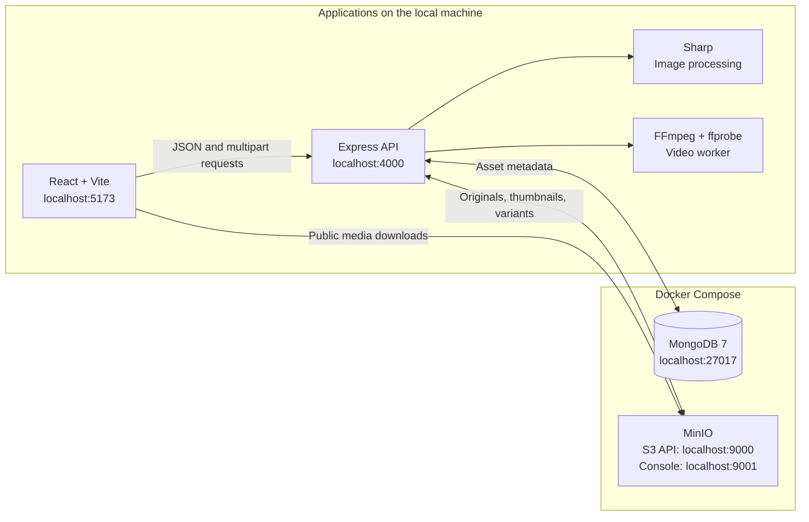

# Frame - Media Asset CMS

**Build91 SDE Intern Evaluation Project**

Frame is a full-stack media library for uploading, organizing, previewing, and optimizing images and videos. Its central workflow is content replacement: a user can update a file while retaining the filename, format, and public URL already used by external websites or applications.

The application combines a React dashboard with an Express API, MongoDB metadata storage, and S3-compatible object storage. Local development uses MongoDB and MinIO through Docker Compose, so reviewers can run the project without an AWS or Cloudflare account.

[Assignment coverage](#assignment-coverage) · [Architecture](#architecture) · [Local setup](#local-setup) · [Review walkthrough](#review-walkthrough) · [Verification](#verification)

## Assignment coverage

| Requirement | Implemented behavior |
| --- | --- |
| S3 integration and bucket selection | Server-side storage credentials, a validated bucket allowlist, configurable public URLs, and automatic multipart uploads. The backend supports multiple preconfigured buckets. |
| Content replacement | Overwrites the original storage key while retaining the filename, extension, MIME type, and public URL. Updates the asset version and thumbnail, and removes outdated optimized variants. |
| Media gallery and previews | Responsive gallery with generated image/video thumbnails, image previews, video playback, pagination, and loading, empty, and error states. |
| Search and filtering | Case-insensitive filename search, format filters, upload-date ranges, and bucket selection. |
| Image optimization | Resizing, quality adjustment, and conversion to WebP, AVIF, JPEG, or PNG using Sharp. Displays actual output dimensions, file size, and savings. |
| Video optimization | Resolution, bitrate, codec, and CRF quality controls using FFmpeg. Generates H.264/MP4 or VP9/WebM variants with background processing status and saved output. |
| Attribute management | Editable alt text, tag chips, and an optional expiry date that can be cleared. |
| Error handling | File-size, extension, MIME type, and media-content validation; duplicate detection; per-file upload progress; retry controls; centralized API errors; cleanup and rollback on failures. |

**Supported uploads:** JPG, JPEG, PNG, WebP, GIF, AVIF, MP4, WebM, and MOV. The default limit is **200 MiB per file**; the interface labels this as 200 MB. Multiple-file selection sends each file as an individual upload.

The local configuration exposes one bucket, displayed as **Dhruv-assets**. Its storage identifier remains `dev-assets` to preserve existing asset URLs. Additional buckets can be enabled through the backend configuration.

## Architecture



MongoDB stores asset metadata, versions, editable attributes, and video job states. Object storage holds the original files, thumbnails, and optimized variants. Express coordinates validation, persistence, and media processing; the browser retrieves media through public storage URLs.

| Layer | Technology |
| --- | --- |
| Frontend | React 19, Vite 7, JavaScript/JSX, CSS |
| Backend | Node.js, Express 5, JavaScript ES modules |
| Database | MongoDB 7 with Mongoose |
| Storage | AWS SDK v3 with MinIO locally; configurable AWS S3 or Cloudflare R2 |
| Media processing | Sharp for images; bundled FFmpeg and ffprobe for videos |
| Verification | Node.js test runner, HTTP/curl checks, Chromium browser automation |

### Key implementation decisions

- **Stable asset identity:** replacement retains the existing object key and public URL. The version increases, thumbnails are regenerated, and previous variants are invalidated.
- **Versioned optimization:** image variants are generated on request and cached by version and settings. Video jobs return promptly, persist their status, and run in a bounded background queue. Identical requests reuse current output.
- **Controlled uploads:** Multer writes incoming files to temporary disk storage, and the AWS SDK manages multipart uploads. Files are checked against supported extensions, MIME types, and decoded content.
- **Failure recovery:** upload failures trigger object cleanup. Replacement keeps the previous original and thumbnail bytes for rollback. Per-asset locks serialize conflicting operations within one backend process.
- **Separation of concerns:** routes, validation, storage access, media processing, database models, and UI components have separate modules. The API contract and provider setup are documented independently.

## Local setup

### Prerequisites

- **Git** and **Node.js with npm**. Supported Node versions are 20.19 or newer within the 20.x series, or 22.12 and newer.
- **Docker with Compose v2**. On Windows, start Docker Desktop with Linux containers enabled.
- Available ports: **4000**, **5173**, **27017**, **9000**, and **9001**.

Dependencies include the Sharp, FFmpeg, and ffprobe binaries for supported platforms. The first installation needs an internet connection for packages and Docker images; a separate system FFmpeg installation is not required.

### 1. Clone the repository

```sh
git clone https://github.com/dhruv086/frame-media-library.git
cd frame-media-library
```

All commands below run from the repository root. The frontend and backend have separate package files and lockfiles.

### 2. Configure and install

The example environment files contain working local defaults. The commands below preserve any existing environment files.

**Windows PowerShell:**

```powershell
if (-not (Test-Path -LiteralPath backend/.env)) {
    Copy-Item backend/.env.example backend/.env
}
if (-not (Test-Path -LiteralPath frontend/.env.local)) {
    Copy-Item frontend/.env.example frontend/.env.local
}

npm.cmd --prefix backend ci
npm.cmd --prefix frontend ci
```

**macOS/Linux:**

```sh
if [ ! -f backend/.env ]; then
    cp backend/.env.example backend/.env
fi
if [ ! -f frontend/.env.local ]; then
    cp frontend/.env.example frontend/.env.local
fi

npm --prefix backend ci
npm --prefix frontend ci
```

`npm ci` installs the versions recorded in the committed lockfiles. Subsequent examples use `npm.cmd` for Windows PowerShell; **use `npm` on macOS/Linux**.

### 3. Start the database and object store

With Docker running:

```sh
docker compose -f backend/docker-compose.yml up -d
docker compose -f backend/docker-compose.yml ps -a
```

Wait for `mongo` to be running and `minio` to be healthy. The `minio-init` service should finish with exit code `0`; it creates `dev-assets` and enables public media downloads. Its exited state is expected after successful initialization.

### 4. Start the applications

**Terminal 1 - backend:**

```powershell
npm.cmd --prefix backend run dev
```

Wait for `Media Asset CMS listening on http://localhost:4000`.

**Terminal 2 - frontend:**

```powershell
npm.cmd --prefix frontend run dev
```

Open **http://localhost:5173**. The dashboard should show **Connected** and **Dhruv-assets**. A fresh installation starts with an empty gallery.

Check database readiness at **http://localhost:4000/api/health**:

```json
{ "status": "ok", "database": "connected" }
```

### Local service addresses

| Service | Address |
| --- | --- |
| Dashboard | http://localhost:5173 |
| Backend API | http://localhost:4000 |
| MongoDB | `mongodb://localhost:27017/cms` |
| MinIO S3 API | http://localhost:9000 |
| MinIO console | http://localhost:9001 |

The MinIO console uses **`minioadmin` / `minioadmin`**, the credentials in the local Compose configuration. React and Express run on the host machine; Docker runs MongoDB and MinIO.

To stop the project, press `Ctrl+C` in both application terminals, then run:

```sh
docker compose -f backend/docker-compose.yml stop
```

Named Docker volumes preserve the database and media. To resume, run Compose with `up -d` and restart the two application commands.

### Configuration

| File | Purpose |
| --- | --- |
| [`backend/.env.example`](backend/.env.example) → `backend/.env` | API port, allowed frontend origin, MongoDB connection, upload limit, and storage configuration. |
| [`frontend/.env.example`](frontend/.env.example) → `frontend/.env.local` | `VITE_API_URL`, set to `http://localhost:4000` locally. |

The backend uses `BUCKETS` as its allowlist and `BUCKET_PUBLIC_URLS` to map each bucket to a public download base. Credentials remain in the backend; `VITE_` values are exposed to the browser. Actual environment files are ignored by Git, and example files are committed. Restart the relevant application after changing its environment.

The default backend configuration is:

```dotenv
PORT=4000
CLIENT_ORIGIN=http://localhost:5173
S3_ENDPOINT=http://localhost:9000
S3_ACCESS_KEY=minioadmin
S3_SECRET_KEY=minioadmin
S3_REGION=us-east-1
BUCKETS=dev-assets
BUCKET_PUBLIC_URLS=dev-assets=http://localhost:9000/dev-assets
MONGO_URI=mongodb://localhost:27017/cms
MAX_UPLOAD_MB=200
```

For AWS S3 or Cloudflare R2, configure the provider endpoint/region, credentials, buckets, public read access, and browser CORS. See [backend configuration](backend/README.md#configuration) and [R2 setup](backend/R2_SETUP.md). Changing providers does not migrate existing objects or rewrite stored URLs.

## Review walkthrough

After starting the project, the following actions cover the main assignment workflows:

1. **Upload:** add an image and a video through **Upload assets**. Inspect progress, gallery thumbnails, and the resulting metadata.
2. **Find and preview:** search by filename, apply a format or upload-date filter, and open each asset's preview.
3. **Replace:** copy an image's original URL, replace its content with another file of the same format, and confirm that the URL is unchanged while the version increases. `.jpg` and `.jpeg` are treated as separate extensions.
4. **Optimize:** generate a WebP or AVIF image and compare its dimensions and file size with the original. For video, change resolution, bitrate, codec, and CRF, then preview the generated output.
5. **Manage attributes:** edit alt text, tags, and expiry; reopen the asset to check persistence. Use **Copy URL** or confirmed **Delete** to inspect the remaining management actions.

Optimization creates a separate file and preserves the original. Reported savings use actual output bytes; some settings can produce larger output. Video resolution preserves aspect ratio without upscaling.

## Verification

Automated checks cover validation boundaries, real image/video processing, stable-URL replacement, filtering, metadata edits, storage failures, rollback, concurrent operations, and desktop/mobile UI workflows. See the [test report](backend/TEST_REPORT.md) for recorded results and coverage details.

Run commands from the repository root after installing dependencies and creating the environment files:

| Command | Purpose | Required services |
| --- | --- | --- |
| `npm.cmd --prefix backend test` | Unit, validation, error-handling, and real media-processing tests. | No running services. |
| `npm.cmd --prefix backend run test:api` | API workflows, storage integration, failure recovery, and concurrency. Starts an isolated API and test database. | MongoDB and MinIO. |
| `npm.cmd --prefix backend run test:integration` | Curl-based end-to-end API checks. | Running backend, MongoDB, MinIO, and curl. |
| `npm.cmd --prefix backend run test:storage` | Public downloads, CORS, multipart uploads, overwrite, and cleanup. | Configured object store. |
| `npm.cmd --prefix frontend test` | API client, upload progress, validation, and display utilities. | No running services. |
| `npm.cmd --prefix frontend run test:api` | Read-only checks of the backend contract. | Running backend and its services. |
| `npm.cmd --prefix frontend run test:browser` | Browser upload, replacement, previews, optimization/playback, metadata, and responsive layouts. | Both applications, MongoDB, MinIO, and Chromium. |
| `npm.cmd --prefix frontend run build` | Production frontend build in `frontend/dist/`. | No running services. |

Integration checks create uniquely named fixtures and clean up their own data. The backend API suite uses an isolated `cms_test_*` database and a 12 MiB test upload limit. The browser script defaults to Microsoft Edge on Windows; set `BROWSER_PATH` to another Chromium executable when needed. Screenshots are saved under ignored `frontend/test-results/`.

To preview the frontend build, stop its development server and run `npm.cmd --prefix frontend run preview`. Both commands use port 5173. The backend and storage services must remain running. Use `npm.cmd --prefix backend start` to run Express without nodemon.

## Project structure

```text
frame-media-library/
|-- README.md
|-- backend/
|   |-- src/
|   |   |-- config/          # Environment, MongoDB, and S3 setup
|   |   |-- middleware/      # Upload handling and API errors
|   |   |-- models/          # Asset and video-variant metadata
|   |   |-- routes/          # Asset and bucket endpoints
|   |   |-- services/        # Assets, storage, images, and video jobs
|   |   `-- utils/           # Validation and per-asset locks
|   |-- test/               # Unit and media-processing tests
|   |-- scripts/            # Integration and storage checks
|   `-- docker-compose.yml  # MongoDB and MinIO
`-- frontend/
    |-- src/
    |   |-- api/            # Requests and upload progress
    |   |-- components/     # Gallery, dialogs, and media controls
    |   |-- hooks/          # Asset loading and notifications
    |   `-- pages/          # Dashboard
    |-- tests/              # Client and utility tests
    `-- scripts/            # API and browser checks
```

## Technical notes and limitations

- **Replacement caching:** original files and thumbnails allow five minutes of caching. The app adds version parameters to refresh its previews; external consumers of the unchanged URL may retain previous content until their cache expires. Optimized variants use versioned keys with immutable caching.
- **Expiry:** expiry dates are editable metadata, stored as the end of the selected UTC day. They do not automatically delete files or restrict access.
- **Processing model:** locks and video jobs run within one Node.js process. The queue accepts 10 active/pending jobs and processes one at a time. Interrupted jobs become retryable failures after restart; multiple backend instances would require distributed coordination.
- **Consistency and memory:** request failures have cleanup/rollback paths, but a crash between MongoDB and storage writes can require reconciliation. Processing can buffer original files; sustained load and peak memory at the 200 MiB limit have not been benchmarked.
- **Access:** the local setup uses public media downloads and development credentials. Application authentication and authorization are not implemented.
- **Media behavior:** animated image inputs produce a still optimized image. Original video playback depends on browser codec support; H.264/MP4 and VP9/WebM outputs provide the implemented conversion options.
- **Provider verification:** integration was verified with local MinIO. AWS S3 and Cloudflare R2 configuration is supported, but those providers have not been tested live in this workspace.

## Troubleshooting

| Issue | Resolution |
| --- | --- |
| PowerShell blocks `npm.ps1` | Use `npm.cmd` as shown above. |
| Docker is unavailable | Start Docker Desktop or the Docker daemon; on Windows, use Linux containers. |
| A required port is occupied | Stop the conflicting process. If changing ports, update the service mapping and environment values together. |
| Backend cannot connect to MongoDB | Inspect `docker compose -f backend/docker-compose.yml ps -a` and the `mongo` logs; confirm `MONGO_URI`. |
| Bucket initialization fails | Inspect `docker compose -f backend/docker-compose.yml logs minio-init`. Once MinIO is healthy, rerun `docker compose -f backend/docker-compose.yml run --rm minio-init`. |
| Dashboard shows Unavailable | Check `/api/health`, `VITE_API_URL`, and `CLIENT_ORIGIN`; restart after environment changes. |
| Upload works but previews fail | Check the public object URL, bucket read access, and CORS. Run the configured-storage check. |
| Duplicate or replacement validation error | Use **Replace** for an existing normalized filename and match the original extension/MIME type. |
| Media dependency installation fails | Check the supported Node version, platform, and access to binary downloads before rerunning backend `npm ci`. |

## Further documentation

- [API contract](backend/API.md): endpoints, request/response formats, filters, error codes, and optimization settings.
- [Backend README](backend/README.md): storage configuration and implementation details.
- [Frontend README](frontend/README.md): UI behavior, API integration, and browser verification.
- [Cloudflare R2 setup](backend/R2_SETUP.md): provider credentials, public access, and CORS configuration.
- [Test report](backend/TEST_REPORT.md): recorded verification results, failure scenarios, and remaining limits.
